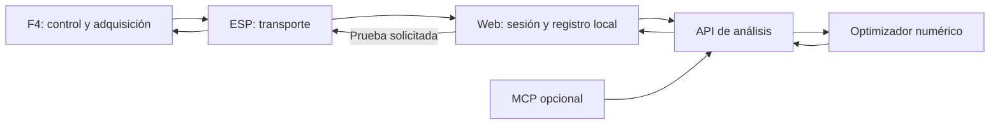

# Plan de implementación: calibración IR y balance de AutoMicro

Fecha: 2026-10-01. Estado: propuesta de implementación, basada en lectura de código. No implementa todavía la nueva interfaz ni el servicio PID. No se ejecutaron tests, compilaciones, validaciones ni pruebas físicas.

## Objetivo y alcance

Reescribir la presentación de calibración existente como un espacio de trabajo que reúna dos procedimientos independientes: sensores IR y balance. Conservar perfiles, importaciones, exportaciones y geometría IR a 5 cm. Incorporar sesiones de balance reproducibles, análisis de la dinámica y propuestas de PID con comparación contra la configuración vigente. El control en tiempo real permanece en la F4.

Este plan autoriza y describe trabajo futuro; no supone autorización para modificar FirmwareF4, Firmware ESP01 o Qt desde este checkout. Las dependencias de esos repositorios deben abordarse en tareas explícitas. No crea ni publica un contrato nuevo por el solo hecho de proponerlo.

## Punto de partida observado

- `/statics` renderiza `src/pages/EstadoSection.tsx`; la calibración se abre en un modal con `src/features/ir/IrCalibrationWorkbench.tsx`.
- El perfil IR se mantiene en estado y localStorage mediante la clave `uner.ir-object-calibration.v1`. El parser admite perfiles anteriores. El modelo del perfil y la captura pertenecen a `src/features/ir/irCalibration.ts`.
- La captura IR descarta muestras de asentamiento y evita duplicados con `sampleSeq` y `tickMs`. Conserva estadísticas por sensor y distancia; permite importar/exportar JSON y generar una tabla C.
- El alcance configurado está centralizado en `IR_MAX_RANGE_CM = 5`, con 11 distancias y 5 canales. Los puntos antiguos mayores de 5 cm se conservan como históricos y se excluyen de las curvas activas.
- `src/protocol/f4Payloads.ts` decodifica telemetría con ángulo medido/objetivo, salidas izquierda/derecha, Kp/Ki/Kd, error, integral, derivada y estados de balance/parada. Ese snapshot no contiene timestamp F4, secuencia, período de control ni tensión de batería.
- El snapshot de control declara velocidad estimada y saturación; el MPU tiene datos giroscópicos. Son mensajes separados: no asumir que corresponden al mismo instante ni que la velocidad estimada equivale a una medición por encoder.
- `src/protocol/wsApi.ts` declara `getTelemetrySnapshot`, `getControlSnapshot`, `getPreferences` y `setPreferences`. Sus nombres y los decoders no prueban un flujo operativo de autotuning ni escritura de ganancias. Se debe trazar productor, bridge y consumidor antes de reutilizar cualquier comando.

## Diseño: identidad, interacción y cobertura

Fuentes de identidad: `docs/design-system/index.md`, `tokens.json`, `components.md`, `decisions.md` y `sources.md`. Manual 0.3.0 en borrador con autorización previa de aplicación registrada. Las fuentes canónicas son login, home, control, WiFi y statics; la nueva calibración es el objetivo, no una fuente nueva de marca.

Visual Identity System gobierna marca, paleta, tokens y componentes. Apple Design aporta jerarquía, respuesta inmediata, continuidad y revelado de opciones avanzadas. Emil Design Engineering aporta valores por defecto, claridad de estados y movimiento breve con propósito. Cuando una receta aspiracional contradiga el manual o la precisión de una medición, prevalecen identidad y legibilidad técnica.

| Decisión | Evidencia | Cobertura | Aprobación / verificación |
| --- | --- | --- | --- |
| Nombre, logo y variantes fijas de color | Confirmada, manual D-14 | Cubierta | Base aprobada; nueva pantalla no verificada |
| Tokens de superficies, texto, foco y estados | Observada en manual y CSS | Parcial | Borrador autorizado; nueva pantalla no verificada |
| Dos procedimientos: IR y Balance | Propuesta | No cubierta | Propuesta en este plan |
| Asistente de sesión y comparación de PID | Propuesta | No cubierta | Propuesta en este plan |
| Vista móvil y escritorio, claro y oscuro | Propuesta de cobertura | No cubierta en ejecución | Pendiente de revisión solicitada por el usuario |

### Composición propuesta

Mantener el acceso desde `/statics`. Reemplazar el modal técnico largo por un workspace de calibración amplio, de pantalla completa en móvil, usando el diálogo compartido y preservando foco y bloqueo de scroll. No agregar una ruta nueva en la primera entrega.

1. Cabecera: **Calibración**, dispositivo, estado del enlace y botón de salida.
2. Selector de procedimiento: **Sensores IR / Balance**. Cambiar de procedimiento no destruye borradores. Una captura activa debe detenerse explícitamente antes de iniciar la otra.
3. Progreso contextual: **Preparar → Registrar → Analizar → Aplicar**. En IR, la última etapa distingue usar en la web de exportar para firmware.
4. Área principal: instrucciones y acción del paso actual; gráficos y resultados junto a los controles que los afectan.
5. Resumen lateral en escritorio, debajo en móvil: perfil vigente, sesión seleccionada y estado de datos.
6. Barra de acción estable: un botón principal por paso y acciones secundarias. Durante una prueba física, **Detener prueba** permanece visible y operativo.

| Before | After | Why |
| --- | --- | --- |
| Formulario IR, tabla y exportación dentro del mismo panel | Paso activo con instrucciones y resultados progresivos | Reduce carga inicial conservando herramientas |
| Calibración presentada como operación única | IR y Balance con perfiles independientes | Evita confundir distancia óptica con control de equilibrio |
| Perfil local sin historial de sesiones de balance | Sesiones fechadas y comparación de configuraciones | Permite reproducir y explicar una recomendación |
| Sin flujo de propuesta PID | Configuración actual, candidata y diferencias con métricas | Hace concreto lo que se aplicaría al auto |

### Procedimiento IR

- Preparar: material del blanco, luz ambiente, orientación y origen de distancia en el emisor. Explicar que 5 cm es un límite configurado, no una precisión garantizada.
- Registrar: referencia sin objeto y puntos por canal hasta 5 cm, señalando puntos pendientes, capturas completas y dispersión.
- Analizar: gráfica ADC/distancia, referencia, dispersión e intervalos ambiguos. No invertir automáticamente una curva no monótona como si cada ADC tuviera una distancia única.
- Aplicar: usar el perfil en la web o exportar JSON/C. Exportar C no equivale a instalarlo en la F4.
- Mantener importación de perfiles anteriores y etiquetas de histórico fuera de rango. No borrar mediciones como parte de la migración.

### Procedimiento Balance

- Preparar: conexión, capacidad de firmware, parámetros actuales, condiciones del vehículo y plan de captura. Mostrar el motivo concreto si una operación no está disponible.
- Registrar: sesión base con ángulo objetivo/medido, salidas y términos PID. Datos reales, reproducción y simulación llevan etiquetas visibles distintas.
- Analizar: gráficas de ángulo, error, P/I/D y salidas de motor; calidad de adquisición; comparación de candidato y base. Un resultado puede ser **datos insuficientes** o **sin candidato admisible**.
- Aplicar: mostrar valores y límites; iniciar prueba temporal explícita, recuperar configuración anterior o conservar parámetros tras la evaluación física. La primera versión será asistida.
- Historial: condición de batería/carga, versión de firmware, versión del algoritmo, conjunto de datos, resultado y motivo de rechazo o reversión.

### Cinco reglas visuales e interactivas

1. Consumir tokens y componentes compartidos; conservar logo y paleta de AutoMicro.
2. Priorizar texto y datos sobre transparencias; tablas y gráficos sobre superficies legibles, sin blur anidado.
3. Colocar conexión, frescura y capacidad junto a las acciones que dependen del hardware. Color siempre acompañado por texto o icono.
4. Mantener números tabulares, unidades explícitas, foco visible y controles de al menos 44 px. Los detalles técnicos se revelan bajo **Avanzado**.
5. Respuesta de pulsación inmediata; transiciones propuestas de 160–240 ms para paneles, sin bloquear entrada. Gráficas y mediciones no llevan interpolación decorativa. Respetar movimiento reducido, teclado y preferencia de transparencia reducida.

## Arquitectura y contratos propuestos

La nube no manda PWM ni ejecuta el balance. La Web inicia operaciones; la F4 decide si puede aplicarlas y garantiza parada y reversión local. Desconexión de Web/ESP, cierre de pestaña o indisponibilidad del servidor no deben impedir esas protecciones.

### Registro de sesión

Metadatos propuestos: versión de esquema, dispositivo, firmware, parámetros de control y filtro, unidades/signos/ejes, período nominal, condiciones de batería y carga, configuración inicial y plan de adquisición.

Cada muestra sincronizada debe tener secuencia, tiempo monotónico F4, dt de control, ángulo objetivo/medido, velocidad angular usada por el controlador, error, estado integral, derivada filtrada, contribuciones de P/I/D y PWM aplicado por motor. Agregar saturación, modo y estado de parada. Batería o encoders solo se incluyen como medidos cuando el hardware los provea; caso contrario se declara ausencia o condición manual.

La F4 debe producir un registro consistente del mismo ciclo. Calcular P/I/D desde los estados actuales solo es correcto si se confirma la ecuación real, escalado, filtros y límites. La hora de llegada Web no sustituye el tiempo de adquisición.

Captura con buffers acotados, bloques con secuencias y pérdidas explícitas. La tasa se decide desde la dinámica, frecuencia real del control y presupuesto UART/WebSocket; no fijar 100 Hz por conveniencia de interfaz. Registrar localmente sesiones en IndexedDB, mantener el perfil IR actual y permitir exportar/reimportar sesiones sin Internet.

### Servicio de análisis

Empezar con un worker numérico local consumido mediante un adaptador HTTP. Para nube: API/Cloud Function de recepción y creación de trabajo, almacenamiento de datos y resultados, Cloud Tasks y worker en Cloud Run. La Web conserva el identificador del trabajo y puede recuperar el resultado tras una desconexión. Esta distribución es una propuesta, no infraestructura existente.

Operaciones propuestas: crear sesión de análisis, consultar estado, obtener resultado y cancelar trabajo. Usar esquema versionado, autenticación independiente de la sesión PIN del ESP, límites de tamaño, idempotencia y política de retención. No asumir que ya existe proyecto Firebase configurado. Si el sitio servido por ESP tiene problemas de HTTPS/CORS o conectividad AP, resolver el transporte en esa fase; mientras tanto funciona exportación/análisis local.

MCP opcional expone análisis de sesión, identificación, propuesta y comparación usando el mismo servicio. No agrega un optimizador diferente ni permite aplicar ganancias automáticamente por iniciativa del modelo de lenguaje. El algoritmo numérico y sus versiones son la autoridad del cálculo; el asistente explica resultados.

### Resultado propuesto

Estado, dataset y firmware compatibles, parámetros de partida, candidato Kp/Ki/Kd, período y forma discreta del controlador, filtro D, anti-windup y límites. Incluir modelo identificado, errores de ajuste, métricas base/candidato, sensibilidad, límites de validez y motivos de rechazo. Separar predicción simulada de resultado físico.

Los nuevos comandos/eventos de captura, prueba temporal, cancelación, reversión y persistencia deben definir dueño, correlación, permisos, unidades, payload, ACK intermedio y resultado final. Los nombres e IDs se decidirán tras inspeccionar F4/ESP; este plan no los reserva. No reutilizar `setPreferences` sin demostrar soporte de esos campos y su secuencia de aplicación.

## Método de optimización

1. Confirmar implementación discreta real: signo de salida, dt, unidades, filtro, saturación, anti-windup, mezcla de motores y orden de lazos.
2. Obtener una base estable. Si no existe, detener autotuning y trabajar primero en puesta en marcha supervisada; no buscar oscilaciones críticas con el vehículo libre.
3. Identificar un modelo alrededor del equilibrio mediante datos en lazo cerrado y excitación acotada. Una sesión sin excitación suficiente puede no identificar parámetros; registrar esa limitación.
4. Ajustar conjuntamente las ganancias con restricciones. Usar un costo normalizado que combine error angular, oscilaciones, recuperación, deriva/velocidad cuando sea observable, esfuerzo y saturación. Registrar pesos y razones; no presentarlos como porcentajes universales de P/I/D.
5. Evaluar candidatos frente a incertidumbre de modelo, retardos, ruido y condiciones de batería/carga disponibles. Separar sesiones de ajuste y evaluación. Los márgenes de estabilidad del modelo no garantizan estabilidad física fuera de su región de validez.
6. Calcular sensibilidad variando cada ganancia alrededor del candidato y mostrar el efecto previsto en las métricas. Si existen interacciones fuertes, mostrarlas; no atribuir toda mejora a un solo término.
7. Probar temporalmente un candidato con límites y plazo de vigencia impuestos por F4, transferencia sin saltos de salida y reversión local. Guardar de forma persistente solo como operación separada.

P corrige la inclinación; D aporta amortiguación y necesita tratamiento del ruido; I compensa sesgos con anti-windup. Elegir PD/PID según la estructura real. Si existe un lazo de velocidad, cerrar primero el lazo interno de balance y después ajustar el externo. No prometer que un PID único resolverá toda la dinámica del auto.

## Entregas y dependencias

| Etapa | Trabajo | Resultado concreto | Dependencia |
| --- | --- | --- | --- |
| 1. Workspace | Reescribir UI de calibración y extraer componentes compartidos | IR funcional, selector Balance y estados de capacidad honestos | Solo Web; conservar perfiles |
| 2. Sesiones locales | Modelo versionado, IndexedDB, importación/exportación y reproducción | Sesiones consultables sin nube; datos actuales marcados como adquisición limitada | Solo Web; sin afirmar aptitud para autotuning |
| 3. Adquisición sincronizada | Productor F4, bridge ESP, consumidor Web y registro central | Muestras coherentes con secuencia, tiempos y pérdidas | Tareas explícitas en F4/ESP; contrato comunicado |
| 4. Optimizador local | Identificación, métricas, candidato y sensibilidad | Informe reproducible; rechazo explicado cuando faltan datos | Captura adecuada y ecuación de PID confirmada |
| 5. Backend remoto | API, cola, worker, estado, autenticación y almacenamiento | Enviar sesión y recuperar informe; local continúa disponible | Infraestructura y política de datos definidas |
| 6. Prueba de candidato | Aplicación temporal, límites F4, reversión y persistencia separada | Comparación física base/candidato y trazabilidad | Capacidades F4/ESP y ensayo expresamente solicitado |
| 7. Autocalibración | Iteraciones acotadas bajo política explícita; MCP opcional | Mejora gradual con criterio de parada y última configuración estable | Evidencia de fases anteriores |

### Archivos previstos en Web

- `src/pages/EstadoSection.tsx`: integrar nuevo workspace y mantener escena/sensibilidad IR.
- `src/features/ir/IrCalibrationWorkbench.tsx`: separar vistas por paso y conservar lógica de dominio en `irCalibration.ts`.
- `src/features/calibration/` (nuevo): workspace, navegación por pasos, resumen de calidad, historial y componentes de resultados reutilizables.
- `src/features/balanceCalibration/` (nuevo): modelos, estado de sesión, registro, almacenamiento, métricas y comparación.
- `src/services/calibrationAnalysis/` (nuevo): adaptadores local/remoto y seguimiento de trabajos.
- `src/protocol/`: extensiones tipadas solo después de acordar productor y contrato.
- `src/index.css` y `docs/design-system/`: recetas compartidas y matriz de cobertura de nuevas familias, evitando colores literales propios de calibración.

No agregar una biblioteca de animación para resolver transiciones simples. Seleccionar dependencias de cálculo/gráficos cuando se implemente la fase correspondiente y según lo disponible en el proyecto.

## Criterios de entrega y restricciones

- Perfiles IR anteriores conservados; alcance, guía, curva y escena coherentes a 5 cm.
- Ninguna muestra simulada ni tiempo de llegada se presenta como dato de control real.
- Ningún resultado de optimización se presenta como estabilidad física demostrada.
- Parada, watchdog y reversión residen en F4; una respuesta HTTP no acredita aplicación efectiva de ganancias.
- Mostrar configuración confirmada por dispositivo tras aplicación; distinguir pendiente, aceptada, aplicada, rechazada y expirada.
- El paso a ensayo físico requiere una configuración base, condiciones y límites definidos. Los valores concretos de parada no se inventan en esta etapa.
- Toda modificación de contrato compartido exige ficha, actualización y publicación en AutoMicroContracts, con consumidores pendientes y orden de despliegue. Una consulta o este plan no crea ficha.
- No ejecutar tests, builds, validadores, revisión visual o pruebas físicas salvo pedido expreso. Los criterios anteriores describen entregables y futuros ensayos, no resultados ya obtenidos.

## Pendientes y siguiente entrega

Pendientes: ecuación real del PID F4; capacidad de captura y aplicación temporal; batería/encoders disponibles; presupuesto de transmisión; proyecto cloud y autenticación; condiciones de ensayo; criterios y pesos de optimización. La cobertura visual sigue sin revisión en ejecución.

La primera entrega propuesta es el workspace de calibración con IR completo y sesiones locales de Balance; las acciones dependientes de firmware muestran capacidad pendiente. Después se aborda el contrato de adquisición. Esto produce una interfaz útil sin ofrecer una autocalibración inexistente.

Fuentes externas de apoyo:

- [MathWorks: ajuste PID sobre modelo, estabilidad y márgenes](https://www.mathworks.com/help/control/ref/dynamicsystem.pidtune.html).
- [Google Cloud: tareas asíncronas en Cloud Run](https://docs.cloud.google.com/run/docs/triggering/using-tasks).
- [MCP: herramientas expuestas por servidores](https://modelcontextprotocol.io/specification/2025-06-18/server/tools).

Fuentes locales: skills Visual Identity System, Apple Design, Emil Design Engineering y AutoMicro API Integrity; manual visual 0.3.0; archivos de calibración, router y decoders citados; CHANGELOG central y auditorías del 2026-09-29. Las auditorías son referencias históricas, no prueba de compatibilidad vigente de los otros repositorios.

## Implementación inicial — 2026-10-01

Implementado en fuente: workspace IR/Balance en /statics, pasos IR y curva con dispersión, historial IndexedDB y JSON, captura serializada de getTelemetrySnapshot, gráficos de inclinación/motores/aportes, comparación de sesiones, worker inline, optimizador experimental arx2-grid-v1, servicio HTTP local, cliente HTTP y adaptador MCP stdio. Documentación de uso: tools/balance-analysis/README.md.

Las sesiones producidas por la Web se marcan web-arrival y el motor rechaza usarlas para recomendar ganancias. Admite sesiones sincronizadas importadas según esquema v1, con configuración completa y requisitos de adquisición. La propuesta es simulada y no se aplica al vehículo. Pendientes: productor sincronizado F4, bridge/capacidades ESP, prueba temporal y reversión local, implementación cloud con cola y evidencia física. Estos pendientes se comunican en AutoMicroContracts, AMI-20261001-01. No se ejecutaron tests, compilaciones ni validaciones, ni se iniciaron servicios.

## Grupos, materiales y PID — 2026-10-01

Se sustituye el selector manual de polaridad por procedimientos Objetos / Línea / Balance. La F4 fija Línea pull-up y Objetos pull-down; el snapshot ya normaliza ambos grupos. Objetos usa higher-is-closer con norm. Material se elige Blanco/Negro o Personalizado mediante checkbox y nombre. Línea registra medianas raw/norm bajo el montaje real, no una curva de distancia; conserva referencias y exporta JSON sin aplicar umbrales al firmware.

Balance consulta getBalancePid automáticamente, muestra valores reales, permite Modificar/Enviar por setBalancePid (guardado y reset del estado PID), y añade initialPid al log. Procesar con MCP solicita nombre y requiere configurar un conector HTTP futuro; respuesta proposal se conserva como processed en la sesión. Setear valores guarda confirmación de F4 en confirmedPid/appliedAt. El motor sigue rechazando snapshots de llegada Web para optimización. Ver AutoMicroContracts AMI-20261001-02. No se ejecutaron tests ni validaciones.
